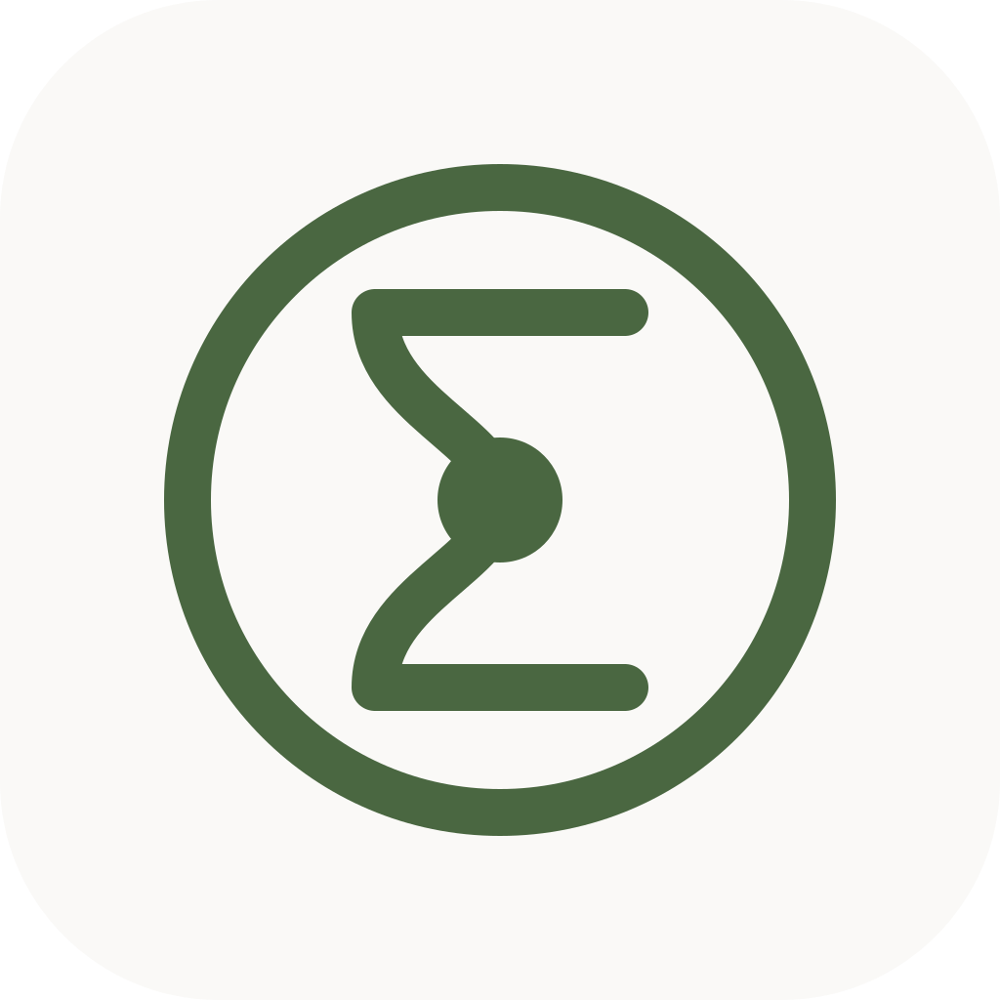

# Kairo

<p align="center">
  
</p>

> A calm, collaborative task app: plan your day, focus on one thing, and do things together with friends. Accessibility-first (ADHD/Autism friendly), with Kairo the calico cat keeping you company.

**Kairo** (from Greek *kairos* - "the opportune moment") helps you manage tasks while staying connected with friends and teammates. See each other's availability, share tasks, and collaborate in real-time.

---

## Features

Four tabs and a create button in a floating bar: **Hoy**, **Planear**, **＋**, **Juntos**, **Yo**.

### Hoy
- Kairo the cat with a concrete suggestion for right now
- Streak, overdue count and how much of the day is done
- A dark "Ahora" card for the next timed task, with a one-tap Focus button
- Pending tasks (overdue and today), a collapsible "Hechas" list, and a link to every task
- A quiet hint when you are offline or changes are syncing

### Tasks
- Create with a title first; date, time, priority and sharing are optional chips
- Swipe to complete or delete, with undo
- Sections: overdue, today, upcoming, no date, completed
- Streaks count from `completed_at`, so only the completion day counts
- **Works offline:** changes are kept on the device and sent when the connection returns

### Planear (calendar)
- **Day and week:** an hour grid with blocks sized by duration; pinch to change density, tap an empty slot to create, drag a block to reschedule
- **Month:** dots per day, with the selected day's agenda below
- **Algún día:** your tasks without a date, one tap away
- Friends' tasks appear in the tone you picked for them; private calendars only show "Busy"

### Juntos (social)
- Search people by username; send, accept, reject and cancel friend requests
- Shared tasks with their progress
- Nudges: a gentle push to a friend about a shared task (at most one every 30 minutes)
- A tone per friend, stored per side of the friendship

### Focus (ADHD-friendly)
- A dark screen with a ring that drains and Kairo concentrating with you
- Four rounds of 25 minutes with 5-minute rests and a 15-minute rest after the fourth; +5 minutes when you need them
- Keeps running in the background and when you leave the screen
- Pick a task to focus on, or just focus

### Kairo, the cat
- A fluffy calico drawn in code (`CustomPainter`), animated with springs
- Moods follow your day: calm, happy, focused, sleeping, worried
- Does cat things on his own (stands, stretches, grooms, yawns) and hops when you complete a task
- Tap for a suggestion; long-press to start focusing
- Holds still when reduced motion is on

### Yo (profile and settings)
- Name, username and photo
- Calendar visibility (public / private) and your own tone
- Appearance (light / dark / system), language (Spanish / English)
- Accessibility: reduce motion, haptics, text size
- Notification preferences
- Kairo's page: what he does and when

### Reminders and notifications
- Soft reminders from a task: 10 / 15 / 30 / 60 minutes
- Push for shared tasks, friend requests and nudges (Firebase Cloud Messaging)
- Streak notifications: earned, close to losing, lost
- In-app notification history with an unread badge on Hoy
- iOS remote push needs a paid Apple Developer account (APNs)

### Sign in and onboarding
- Email and Google sign-in
- A short first-launch tour with Kairo, shown once

### Internationalization
- Spanish (default) and English from ARB files (`lib/l10n/`), switchable in Yo without a restart

### Coming next (2.1)
- Subtasks
- Home screen widget and Live Activities
- Dragging a task from Algún día onto a day

---

## Tech Stack

| | Technology |
|---|---|
| Mobile | Flutter (iOS + Android) |
| Backend | Supabase (Postgres, Auth, Realtime, Storage) |
| State | BLoC Pattern (flutter_bloc) |
| Architecture | Clean Architecture (feature-first) |
| Navigation | go_router |
| DI | get_it + injectable |
| Push | Firebase Cloud Messaging |
| Version | package_info_plus |
| Internationalization | flutter_localizations + ARB (en/es) |
| Persistence | shared_preferences (settings, and the offline task copy and outbox) |
| Connectivity | connectivity_plus |
| Type | Manrope (bundled) |

**100% free and open source.** Core services use free tiers.

---

## Getting Started

### Prerequisites

- macOS (Apple Silicon recommended)
- [Xcode](https://apps.apple.com/app/xcode/id497799835) (from App Store)
- [Flutter SDK](https://docs.flutter.dev/get-started/install/macos) (3.47+)
- [CocoaPods](https://cocoapods.org/) (for iOS)

### Quick Setup

```bash
# 1. Clone the repo
git clone https://github.com/listerineh/kairo-tasks.git
cd kairo-tasks

# 2. Create environment file from example
cp .env.example .env
# Edit .env with your Supabase & Google OAuth credentials

# 3. Install Flutter dependencies
flutter pub get

# 4. Run the app (iOS simulator or connected device)
flutter run --dart-define-from-file=.env

# 5. Or build an APK for Android testing
flutter build apk --split-per-abi
```

### Full Environment Setup (from scratch on Mac)

```bash
# Install Homebrew
/bin/bash -c "$(curl -fsSL https://raw.githubusercontent.com/Homebrew/install/HEAD/install.sh)"

# Install Flutter
brew install --cask flutter

# Install CocoaPods
brew install cocoapods

# Install Xcode from App Store, then:
sudo xcode-select --switch /Applications/Xcode.app/Contents/Developer
sudo xcodebuild -runFirstLaunch

# Verify everything
flutter doctor
```

### iOS on Real Device (Free)

You can test on your iPhone without a paid Apple Developer account:

1. Connect iPhone via USB
2. Enable Developer Mode (Settings → Privacy & Security → Developer Mode)
3. Open `ios/Runner.xcworkspace` in Xcode
4. Set Team to your Personal Team (free Apple ID)
5. Run on device

> Note: Free provisioning certificates expire every 7 days.

### Generate APK

```bash
flutter build apk --split-per-abi
# Find APKs in: build/app/outputs/flutter-apk/
```

---

## Project Structure

```
lib/
├── app/          # App config (theme, router, DI)
├── core/         # Shared utilities & base classes
└── features/     # Feature modules
    ├── auth/     # Authentication
    ├── onboarding/ # First-launch tour
    ├── dashboard/ # Hoy and Kairo the cat
    ├── tasks/    # Task management (offline-first)
    ├── calendar/ # Calendar views (day, week, month)
    ├── social/   # Friends & sharing
    ├── notifications/ # Push & in-app
    ├── focus/    # Focus sessions (ADHD-friendly)
    └── profile/  # User settings
```

Each feature follows Clean Architecture: `domain/` → `data/` → `presentation/`

See [docs/architecture.md](docs/architecture.md) for full details.

---

## Documentation

| Document | Description |
|----------|-------------|
| [AGENTS.md](AGENTS.md) | Project conventions & development guidelines |
| [docs/design.md](docs/design.md) | Design system, tokens, component patterns |
| [docs/architecture.md](docs/architecture.md) | Technical architecture & data flow |
| [docs/redesign-plan.md](docs/redesign-plan.md) | The Kairo 2.0 redesign: direction and phases |
| [docs/supabase-setup.md](docs/supabase-setup.md) | Setting up a new Supabase project |
| [docs/ios-release.md](docs/ios-release.md) | iOS release: TestFlight, push and Sign in with Apple |
| [CHANGELOG.md](CHANGELOG.md) | Version history |

---

## Contributing

We welcome contributions! This project is built to be accessible to developers of all levels.

### How to Contribute

1. **Fork** the repository
2. **Create a branch**: `git checkout -b feature/my-feature`
3. **Follow the conventions** in [AGENTS.md](AGENTS.md)
4. **Write tests** for new functionality
5. **Run checks**: `flutter analyze && flutter test`
6. **Submit a PR** with a clear description

### Guidelines

- Follow the [design system](docs/design.md) for any UI changes
- Follow the [architecture patterns](docs/architecture.md) for new features
- Keep accessibility in mind (44px touch targets, contrast ratios, semantic labels)
- Update CHANGELOG.md with your changes
- One feature/fix per PR

---

## Roadmap

- [x] V 01.00 - Project setup, tasks UI
- [x] V 01.01 - Supabase integration (auth + database)
- [x] V 01.02 - Calendar views (day, week, month)
- [x] V 01.03 - Social features (friends, public calendars, friend colors)
- [x] V 01.04 - Real-time collaboration + shared tasks, onboarding, and in-app locale
- [x] V 01.05 - Push notifications, in-app notifications, iOS toggles, and streak notifications
- [x] V 01.06 - Focus Mode Pomodoro timer (first ADHD accessibility tool)
- [x] V 01.07 - Soft persistent reminders from TaskDetailSheet
- [x] V 02.00 - Kairo 2.0: new design, Kairo the calico cat, Hoy / Planear / Juntos / Yo, focus rounds, nudges, offline tasks
- [ ] V 02.01 - Subtasks, home screen widget, Live Activities

---

## License

MIT License - see [LICENSE](LICENSE) for details.

---

## Acknowledgments

- Design guided by calm computing principles: a quiet palette, clear hierarchy and motion that answers an action
- Built with accessibility in mind, informed by neurodiversity research
- Powered by the incredible Flutter and Supabase communities
